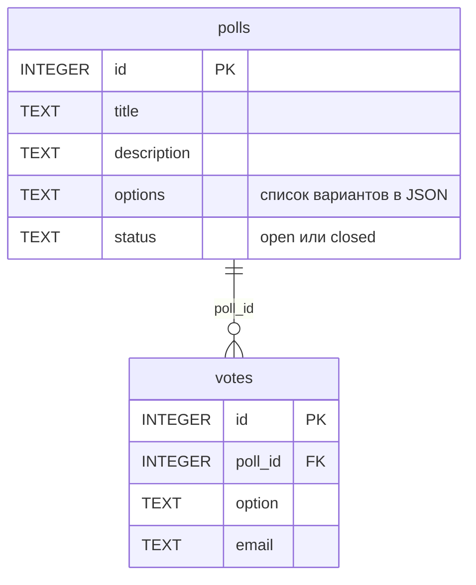

# Опросы: лабораторные 1-2

HTTP-сервис для создания опросов и голосования. Главная сущность: **опрос** (poll), связанная сущность: **голос** (vote).
Стек: Python, Flask, SQLite, Alembic (миграции). Данные хранятся в файле базы и переживают перезапуск.

## Как запустить

```bash
python -m venv .venv
source .venv/bin/activate        
pip install -r requirements.txt
cp .env.example .env            
alembic upgrade head           
python seed.py                 
python main.py
```

Сервис работает на http://localhost:8000, документация Swagger UI: http://localhost:8000/docs.

## Настройки

Строка подключения берётся из переменной окружения `DATABASE_URL` (файл `.env`, образец в `.env.example`, читается в `db.py`).
Пароли и секреты в коде не хранятся, `.env` в git не попадает.

## Поля

**Опрос:** `id`, `title` (обязательное), `description`, `options` (минимум 2 варианта), `status` (`open` или `closed`).
**Голос:** `id`, `poll_id` (ставит сервер из адреса), `option` (один из вариантов опроса), `email`.

## Эндпоинты

| Метод | Путь | Что делает | Коды |
|---|---|---|---|
| GET | /health | проверка сервиса | 200 |
| POST | /api/polls | создать опрос | 201, 400 |
| GET | /api/polls | список; `?limit=10&offset=0&status=open&title=...&q=слово` | 200, 400 |
| GET | /api/polls/stats | статистика: опросы по статусам, голоса, среднее, топ опросов | 200 |
| GET | /api/polls/{id} | получить опрос | 200, 404 |
| PUT | /api/polls/{id} | заменить опрос целиком | 200, 400, 404 |
| PATCH | /api/polls/{id} | изменить часть полей | 200, 400, 404 |
| DELETE | /api/polls/{id} | удалить опрос вместе с его голосами | 204, 404 |
| POST | /api/polls/{id}/votes | проголосовать; в закрытом опросе нельзя | 201, 400, 404, 409 |
| GET | /api/polls/{id}/votes | список голосов опроса; `?limit=&offset=` | 200, 400, 404 |

Ошибки валидации: `400` и тело `{"error": "текст", "field": "имя поля"}`.
Каждый запрос пишется в лог: `GET /api/polls/7 404 1.3ms`.

## ER-диаграмма

Один опрос имеет много голосов, каждый голос относится к одному опросу.



## Миграции и сиды

Схему базы создаёт и меняет **Alembic**. Файлы миграций лежат в `migrations/versions/`:

| Файл | Что делает |
|---|---|
| `0001_create_tables.py` | создаёт таблицы `polls` и `votes` |
| `0002_votes_poll_index.py` | создаёт индекс `idx_votes_poll_id` |

Команды:

```bash
alembic upgrade head      # применить все миграции
alembic current           # какая миграция применена сейчас
alembic downgrade -1      # откатить последнюю миграцию
```

Строку подключения Alembic берёт из той же переменной `DATABASE_URL` (см. `migrations/env.py`).

**Сиды.** Команда `python seed.py` заполняет пустую базу тестовыми данными (4 опроса и голоса, один опрос закрыт).
Если в базе уже есть опросы, сиды ничего не делают.

## Индекс и EXPLAIN

Самый частый запрос сервиса: список голосов одного опроса (`GET /api/polls/{id}/votes`):

```sql
SELECT * FROM votes WHERE poll_id = 1 ORDER BY id LIMIT 10 OFFSET 0;
```

Индекс по `votes.poll_id` создаёт миграция `0002_votes_poll_index.py`:

```sql
CREATE INDEX IF NOT EXISTS idx_votes_poll_id ON votes (poll_id);
```

Без индекса база читает всю таблицу голосов:

```
EXPLAIN QUERY PLAN SELECT * FROM votes WHERE poll_id = 1 ORDER BY id LIMIT 10 OFFSET 0;

SCAN votes
```

С индексом база находит нужные строки по индексу:

```
EXPLAIN QUERY PLAN SELECT * FROM votes WHERE poll_id = 1 ORDER BY id LIMIT 10 OFFSET 0;

SEARCH votes USING INDEX idx_votes_poll_id (poll_id=?)
```

`SEARCH ... USING INDEX` означает, что индекс используется, `SCAN` означает полный перебор таблицы.
Проверить самому (формулировка вывода может немного отличаться в разных версиях SQLite):

```bash
python -c "import sqlite3; [print(r[3]) for r in sqlite3.connect('polls.db').execute('EXPLAIN QUERY PLAN SELECT * FROM votes WHERE poll_id = 1 ORDER BY id LIMIT 10 OFFSET 0')]"
```

## Поиск

`GET /api/polls?q=слово` ищет опросы, в названии которых есть слово или его часть, **без учёта регистра** (в том числе для кириллицы).
Поиск выполняет база: условие `py_lower(title) LIKE ?` в SQL. SQLite сама не различает регистр только у латиницы,
поэтому в `db.py` в базу добавлена функция `py_lower`, которая приводит строку к нижнему регистру. Знаки `%` и `_` в запросе
пользователя экранируются и считаются обычными символами. Поиск работает вместе с фильтром и пагинацией.

## Правило темы: в закрытом опросе голосовать нельзя

Если у опроса `status = closed`, `POST /api/polls/{id}/votes` отвечает `409 Conflict` и объясняет причину:
`{"error": "опрос закрыт, голосовать нельзя"}`.

Проверка статуса и запись голоса выполняются в **одной транзакции** (`BEGIN IMMEDIATE` ... `COMMIT`, см. `transaction` в `db.py`).
Пока транзакция не завершена, опрос нельзя закрыть между проверкой и записью. Если случилась любая ошибка, транзакция откатывается (`ROLLBACK`) и голос не записывается.

## Статистика

`GET /api/polls/stats` отдаёт числа, которые считает сама база агрегатными запросами (`GROUP BY`, `COUNT`, `SUM`, `AVG`), а не цикл в Python:

- `by_status`: сколько опросов открыто и закрыто (`GROUP BY status`, `COUNT`);
- `polls_total`, `votes_total`, `avg_votes_per_poll`: всего опросов, всего голосов и среднее на опрос (`COUNT`, `SUM`, `AVG` поверх `LEFT JOIN`);
- `top_polls`: пять самых популярных опросов (`GROUP BY poll`, `ORDER BY` числу голосов).

## Защита от SQL-инъекций

Все значения передаются в SQL отдельно от текста запроса (`?` и кортеж параметров), поэтому строка вида
`'); DROP TABLE polls;--` сохраняется как обычный текст и таблица не удаляется.
