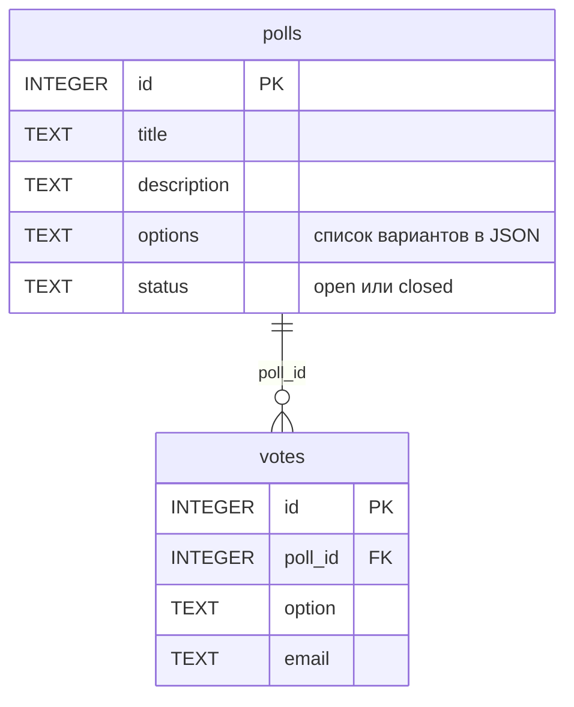

# Опросы: лабораторные 1-2

HTTP-сервис для создания опросов и голосования. Главная сущность: **опрос** (poll), связанная сущность: **голос** (vote).
Стек: Python, Flask, SQLite. Данные хранятся в файле базы и переживают перезапуск.

## Как запустить

```bash
python -m venv .venv
source .venv/bin/activate        # Windows: .venv\Scripts\activate
pip install -r requirements.txt
cp .env.example .env             # Windows: copy .env.example .env
python main.py
```

Сервис работает на http://localhost:8000, документация Swagger UI: http://localhost:8000/docs.
Таблицы создаются автоматически из `schema.sql` при старте. Примеры запросов в `requests.http`.

## Настройки

Строка подключения берётся из переменной окружения `DATABASE_URL` (файл `.env`, образец в `.env.example`).
Пароли и секреты в коде не хранятся, `.env` в git не попадает.

## Поля

**Опрос:** `id`, `title` (обязательное), `description`, `options` (минимум 2 варианта), `status` (`open` или `closed`).
**Голос:** `id`, `poll_id` (ставит сервер из адреса), `option` (один из вариантов опроса), `email`.

## Эндпоинты

| Метод | Путь | Что делает | Коды |
|---|---|---|---|
| GET | /health | проверка сервиса | 200 |
| POST | /api/polls | создать опрос | 201, 400 |
| GET | /api/polls | список; `?limit=10&offset=0&status=open&title=...` | 200, 400 |
| GET | /api/polls/{id} | получить опрос | 200, 404 |
| PUT | /api/polls/{id} | заменить опрос целиком | 200, 400, 404 |
| PATCH | /api/polls/{id} | изменить часть полей | 200, 400, 404 |
| DELETE | /api/polls/{id} | удалить опрос вместе с его голосами | 204, 404 |
| POST | /api/polls/{id}/votes | проголосовать; в закрытом опросе нельзя | 201, 400, 404, 409 |
| GET | /api/polls/{id}/votes | список голосов опроса; `?limit=&offset=` | 200, 400, 404 |
| GET | /api/polls/stats | статистика: опросы по статусам, голоса, среднее, топ опросов | 200 |

Ошибки валидации: `400` и тело `{"error": "текст", "field": "имя поля"}`.
Каждый запрос пишется в лог: `GET /api/polls/7 404 1.3ms`.

## ER-диаграмма

Один опрос имеет много голосов, каждый голос относится к одному опросу.



## Защита от SQL-инъекций

Все значения передаются в SQL отдельно от текста запроса (`?` и кортеж параметров), поэтому строка вида
`'); DROP TABLE polls;--` сохраняется как обычный текст и таблица не удаляется.

## Правило темы: в закрытом опросе голосовать нельзя

Если у опроса `status = closed`, `POST /api/polls/{id}/votes` отвечает `409 Conflict` и объясняет причину:
`{"error": "опрос закрыт, голосовать нельзя"}`.

Проверка статуса и запись голоса выполняются в **одной транзакции** (`BEGIN IMMEDIATE` ... `COMMIT`, см. `transaction` в `db.py`).
Пока транзакция не завершена, опрос нельзя закрыть между проверкой и записью. Если случилась любая ошибка, транзакция откатывается (`ROLLBACK`) и голос не записывается.

## Статистика

`GET /api/polls/stats` отдаёт числа, которые считает сама база агрегатными запросами (`GROUP BY`, `COUNT`, `SUM`, `AVG`), а не цикл в Python:

- `by_status`: сколько опросов открыто и закрыто (`GROUP BY status`, `COUNT`);
- `polls_total`, `votes_total`, `avg_votes_per_poll`: всего опросов, всего голосов и среднее на опрос (`COUNT`, `SUM`, `AVG` поверх `LEFT JOIN`);
- `top_polls`: пять самых популярных опросов (`GROUP BY poll`, `ORDER BY` числу голосов).
