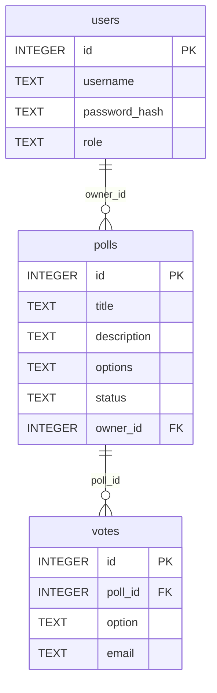

# Опросы

Сервис для создания опросов и голосования. Главная сущность: опрос, связанная: голос.
Flask, SQLite, Alembic, bcrypt, JWT.

## Запуск

```
pip install -r requirements.txt
copy .env.example .env
python -m alembic upgrade head
python seed.py
python main.py
```

Сервис работает на http://localhost:8000, документация на /docs.
Настройки читаются из `.env` (образец в `.env.example`): строка подключения `DATABASE_URL`, секрет токенов `JWT_SECRET`, время жизни токена в минутах `JWT_EXPIRES_MINUTES`, логин и пароль администратора `ADMIN_USERNAME` и `ADMIN_PASSWORD`.

## Сущности

- опрос: id, title, description, options, status (open или closed), owner_id
- голос: id, poll_id, option, email
- пользователь: id, username, пароль (в базе хэш bcrypt)

## Эндпоинты

| Метод | Путь | Доступ | Описание | Коды |
|---|---|---|---|---|
| GET | /health | все | проверка сервиса | 200 |
| POST | /auth/register | все | регистрация | 201, 400, 409 |
| POST | /auth/login | все | вход, возвращает JWT-токен | 200, 400, 401, 429 |
| GET | /auth/me | вошедшие | текущий пользователь (id, username, role) | 200, 401 |
| POST | /api/polls | вошедшие | создать опрос | 201, 400, 401 |
| GET | /api/polls | все | список, параметры limit, offset, status, title, q | 200, 400 |
| GET | /api/polls/stats | все | статистика | 200 |
| GET | /api/polls/{id} | все | получить опрос | 200, 404 |
| PUT | /api/polls/{id} | автор, админ | заменить опрос | 200, 400, 401, 403, 404 |
| PATCH | /api/polls/{id} | автор, админ | изменить часть полей | 200, 400, 401, 403, 404 |
| DELETE | /api/polls/{id} | автор, админ | удалить опрос | 204, 401, 403, 404 |
| POST | /api/polls/{id}/votes | вошедшие | проголосовать | 201, 400, 401, 404, 409 |
| GET | /api/polls/{id}/votes | все | голоса опроса | 200, 400, 404 |

Ошибки валидации приходят в виде `{"error": "текст", "field": "поле"}` с кодом 400.

## ER-диаграмма



## Миграции

Схема создаётся миграциями Alembic из папки `migrations/versions`: таблицы опросов и голосов, индекс, пользователи, автор опроса, роль пользователя.
Применить: `python -m alembic upgrade head`. Тестовые данные: `python seed.py`.

## Индекс

Частый запрос: голоса одного опроса.

```
SELECT * FROM votes WHERE poll_id = 1 ORDER BY id LIMIT 10 OFFSET 0;
```

Индекс `idx_votes_poll_id` по `votes.poll_id` создаётся миграцией `0002`.

Без индекса:

```
EXPLAIN QUERY PLAN SELECT * FROM votes WHERE poll_id = 1 ORDER BY id LIMIT 10 OFFSET 0;
SCAN votes
```

С индексом:

```
EXPLAIN QUERY PLAN SELECT * FROM votes WHERE poll_id = 1 ORDER BY id LIMIT 10 OFFSET 0;
SEARCH votes USING INDEX idx_votes_poll_id (poll_id=?)
```

## Поиск, правило, статистика

- `GET /api/polls?q=слово` ищет по названию без учёта регистра, поиск выполняет база (`LIKE`).
- В закрытом опросе голосовать нельзя, ответ 409. Проверка статуса и запись голоса идут в одной транзакции.
- `GET /api/polls/stats` считает база: `GROUP BY`, `COUNT`, `SUM`, `AVG`.

## Пользователи и доступ

Вход через Basic Auth или по JWT-токену. Читать может любой, создавать опросы и голосовать может вошедший, менять и удалять только автор опроса. Чужой опрос даёт 403, без входа 401.
Автора (`owner_id`) ставит сервер. Проверка доступа находится в `check_access` и `require_owner` в `main.py`.

## JWT

`POST /auth/login` принимает `{"username", "password"}` и возвращает `{"access_token": "...", "token_type": "bearer", "expires_in": 1800}`.
Дальше токен передаётся в заголовке `Authorization: Bearer <токен>`. Токен подписан HS256 секретом `JWT_SECRET`, внутри id пользователя и время окончания.
Подделанный, изменённый и просроченный токен дают 401. Секрет и время жизни берутся из окружения, без `JWT_SECRET` сервис не запускается.

## Администратор

У пользователя есть роль: `user` или `admin`. Администратор может изменять и удалять любые опросы (в том числе без автора). Остальные права у него такие же, как у обычного пользователя.
Через регистрацию стать администратором нельзя: поле `role` в теле запроса игнорируется, роль всегда `user`.
Администратор создаётся при старте сервиса из переменных окружения `ADMIN_USERNAME` и `ADMIN_PASSWORD`. Если пользователь с таким логином уже есть, он становится администратором, а пароль берётся из окружения.
Проверка роли находится там же, где проверка автора: в `require_owner` в `main.py`.

## Лимит попыток входа

Неверные логин или пароль считаются отдельно для каждой пары «адрес клиента и логин» (регистр логина не важен). После 5 неудачных попыток за минуту сервер отвечает 429 и заголовком `Retry-After` с числом секунд ожидания. Пока действует блокировка, не пускает даже верный пароль.
Счётчик считает неудачи и в `POST /auth/login`, и при входе через Basic Auth (`check_credentials` в `main.py`, счётчик `LoginLimiter` в `security.py`). Успешный вход обнуляет счётчик. Счётчик хранится в памяти процесса.

## SQL-инъекции

Значения передаются в запросы параметрами (`?`), поэтому строка `'); DROP TABLE polls;--` сохраняется как обычный текст.
